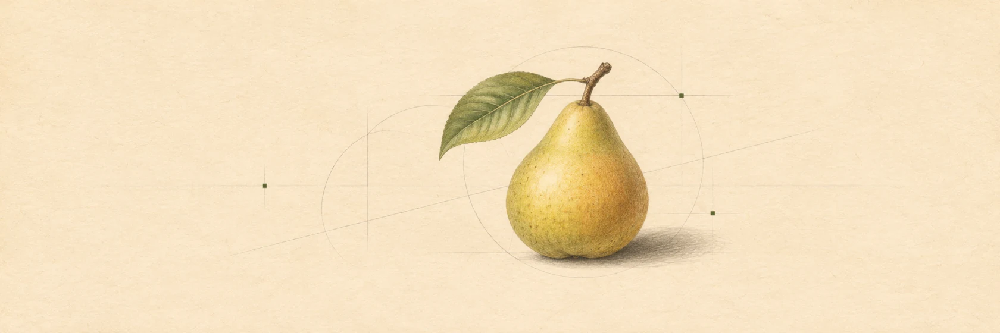

<picture>
  <source media="(prefers-color-scheme: dark)" srcset="./assets/pear-dark.webp">
  
</picture>

# Hi, I’m 李梨 · Li Li

I’m a software engineer in Beijing. I build AI products and developer tools, and I write about what I learn along the way.

[**作品集 · Portfolio**](https://guanlili.github.io/portfolio/) · [**梨园 · Blog**](https://guanlili.github.io/)

## Selected projects

- **[lili-full-stack](https://github.com/guanlili/lili-full-stack)** · Start a FastAPI and React project with authentication, tests, and deployment already wired up.
- **[ai-pr-review](https://github.com/guanlili/ai-pr-review)** · A GitHub Action that runs three AI reviewers in parallel and merges their findings into one pull request review.
- **[devledger](https://github.com/guanlili/devledger)** · Turn AI coding sessions into GitHub Issues and work logs, then export a timesheet for delivery.
- **[AI 人生火锅 · Life Hotpot](https://github.com/guanlili/ai-life-hotpot)** · A hackathon project that turns your hotpot choices into a personal story. [Read how we built it](https://guanlili.github.io/portfolio/ai-hot-pot/).

## Say hello

[Email](mailto:lovelose1921@vip.qq.com) · WeChat 公众号 **李梨同学丶**

My old dream was to raise a panda. This dream remains unrealistic, but emotionally stable.
